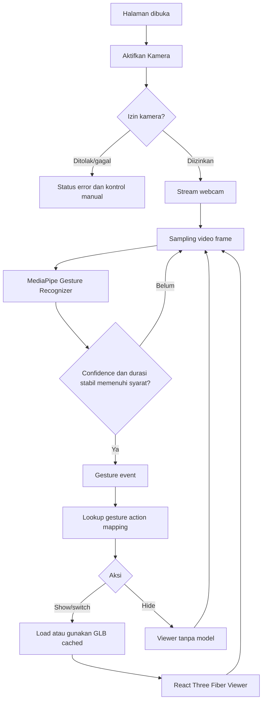

# PRODUCT REQUIREMENTS DOCUMENT (PRD)

# Gesture 3D Viewer — Website Deteksi Gerakan Tangan untuk Menampilkan Model Blender

| Informasi | Detail |
|---|---|
| Nama produk | Gesture 3D Viewer |
| Jenis | Aplikasi web interaktif berbasis computer vision dan 3D |
| Versi dokumen | 1.0 |
| Tanggal | 18 Oktober 2026 |
| Status | Draft — siap untuk perencanaan implementasi |
| Prioritas rilis | MVP berbasis webcam dan 3D viewer terpisah |
| Platform utama | Desktop web; mobile web sebagai pengembangan berikutnya |
| Bahasa antarmuka | Indonesia |

---

## 1. Executive Summary

**Gesture 3D Viewer** adalah aplikasi website yang memanfaatkan webcam untuk mendeteksi gesture tangan pengguna dan menampilkan model 3D yang dibuat di Blender. Aplikasi berjalan di browser dengan inferensi lokal menggunakan MediaPipe dan rendering 3D menggunakan React Three Fiber (berbasis Three.js).

Pada MVP, pengguna melihat dua panel: **Live Camera** untuk preview kamera dan status gesture, serta **3D Viewer** untuk menampilkan model `.glb`. Gesture yang dikenali dipetakan ke aksi yang sudah dikonfigurasi. Sebagai skenario awal:

- **Telapak terbuka (`Open_Palm`)** → tampilkan model busur.
- **Telunjuk ke atas (`Pointing_Up`)** → tampilkan model anak panah.
- **Tangan mengepal (`Closed_Fist`)** → sembunyikan model yang aktif.

Sistem dirancang agar dapat dikembangkan ke gesture custom, kontrol animasi/transformasi model, dan overlay 3D pada kamera (*AR-style*). Pengembangan tersebut **bukan bagian dari MVP**.

### 1.1 Pernyataan masalah

Model 3D hasil Blender umumnya hanya diperlihatkan melalui viewer atau animasi yang dikendalikan mouse/keyboard. Dibutuhkan media presentasi yang memungkinkan pengguna memunculkan asset 3D dengan gerakan tangan secara intuitif, tanpa menginstal aplikasi desktop atau memakai perangkat tracking khusus.

### 1.2 Nilai produk

1. Interaksi natural berbasis gerakan tangan melalui webcam standar.
2. Integrasi langsung dengan asset model Blender berformat `.glb`.
3. Dapat berjalan pada browser modern tanpa backend inferensi.
4. Fondasi reusable untuk demo interaktif, presentasi asset, edukasi, dan eksperimen AR berbasis web.

---

## 2. Tujuan, Hasil, dan Indikator Keberhasilan

### 2.1 Tujuan bisnis/produk

- Menghasilkan prototipe demonstrasi 3D yang dapat dikendalikan gesture tangan.
- Memungkinkan pergantian asset Blender tanpa mengubah pipeline deteksi tangan.
- Menyediakan fondasi yang mudah dikembangkan menjadi aplikasi interaksi objek 3D yang lebih kompleks.

### 2.2 Tujuan pengguna

- Dapat mengaktifkan webcam melalui satu aksi eksplisit.
- Dapat mengetahui apakah tangan dan gesture terdeteksi.
- Dapat memunculkan, mengganti, dan menyembunyikan model 3D secara konsisten.
- Dapat memutar dan memperbesar model 3D melalui kontrol mouse/touch.
- Tetap dapat memilih model secara manual jika kamera tidak tersedia.

### 2.3 KPI / success criteria MVP

| Kode | KPI | Target penerimaan | Cara ukur |
|---|---|---|---|
| KPI-01 | Alur utama berhasil | Ketiga gesture bawaan menghasilkan aksi yang benar pada skenario uji normal | UAT / pengujian manual |
| KPI-02 | Waktu respons gesture | P95 ≤ 700 ms dari gesture stabil secara visual sampai aksi viewer pada perangkat uji referensi | Instrumentasi lokal + rekaman uji |
| KPI-03 | Kelancaran kamera | Target ≥ 15 pemrosesan frame/detik pada laptop uji referensi dalam pencahayaan memadai | FPS counter pengembangan |
| KPI-04 | Kegagalan perubahan model | Tidak ada crash aplikasi ketika asset hilang/gagal dimuat | Pengujian error state |
| KPI-05 | Privasi | Frame webcam tidak diunggah ke server dan tidak direkam secara default | Pemeriksaan network dan kode |
| KPI-06 | Fallback | Pemilihan model manual tetap berfungsi saat akses kamera ditolak | UAT |

**Catatan:** target latensi/FPS adalah target kualitas internal, bukan jaminan untuk semua perangkat dan browser. Perangkat referensi dan hasil benchmark perlu didokumentasikan saat pengujian.

---

## 3. Ruang Lingkup

### 3.1 In scope — MVP (P0)

1. Halaman tunggal aplikasi dengan preview webcam dan panel viewer 3D.
2. Aktivasi, penghentian, dan status akses kamera.
3. Deteksi satu tangan secara real-time memakai MediaPipe Gesture Recognizer.
4. Recognition tiga gesture bawaan (`Open_Palm`, `Pointing_Up`, `Closed_Fist`).
5. Pemetaan gesture ke aksi model berdasarkan konfigurasi.
6. Stabilisasi prediksi gesture agar model tidak berubah karena noise antar-frame.
7. Pemuatan file `.glb` hasil ekspor Blender.
8. Menampilkan model 3D beserta pencahayaan, orbit, zoom, dan reset view.
9. Tampilan status: kamera, gesture terdeteksi, confidence (opsional untuk mode debug), dan model aktif.
10. Loading, error state, permission denied, camera unavailable, dan model load failure.
11. Kontrol manual untuk memilih/menyembunyikan model sebagai fallback dan sarana demo.
12. Responsive layout sederhana untuk desktop dan tablet.
13. Pengolahan kamera secara lokal di perangkat pengguna.

### 3.2 Should have — pasca-MVP (P1)

- Overlay landmark dan skeleton tangan pada preview webcam.
- Pilihan perangkat kamera jika ada lebih dari satu webcam.
- Pengaturan threshold confidence dan durasi stabilisasi di halaman debug.
- Konfigurasi gesture-to-model melalui data JSON, tanpa mengubah kode komponen.
- Optimasi inferensi dengan Web Worker (sesuai kompatibilitas API yang digunakan).
- Transisi animasi halus ketika model ditampilkan/disembunyikan.

### 3.3 Future scope (P2)

- Gesture custom atau klasifikasi gesture yang dilatih sendiri.
- Gesture dinamis yang dipahami dari urutan gerakan, bukan satu pose statis.
- Manipulasi model 3D dengan gerakan tangan: rotate, scale, translate.
- Interaksi busur: mengambil posisi, menarik tali, memicu animasi anak panah.
- Overlay model 3D yang mengikuti posisi tangan pada feed webcam (*AR-style*).
- Kontrol dua tangan, occlusion, dan kalibrasi posisi 3D lanjutan.

### 3.4 Out of scope — MVP

- Backend/API/database, login, akun, dan multi-user.
- Upload model Blender melalui UI atau penyimpanan model cloud.
- Training model machine learning sendiri.
- Interpretasi bahasa isyarat secara penuh.
- Pelacakan tangan presisi tinggi dengan sensor khusus.
- AR dengan positional tracking dunia nyata / WebXR.
- Sinkronisasi realtime antar-device.
- Perekaman/streaming video kamera ke server.

---

## 4. Pengguna Target dan User Stories

### 4.1 Target pengguna

| Pengguna | Kebutuhan |
|---|---|
| Kreator/modeler 3D | Mendemokan asset Blender secara interaktif melalui browser |
| Pengunjung demo | Berinteraksi dengan model tanpa instruksi teknis yang rumit |
| Developer | Menambah model dan aksi gesture secara modular |

### 4.2 User stories

| ID | Sebagai | Saya ingin | Agar |
|---|---|---|---|
| US-01 | Pengunjung | Mengaktifkan webcam setelah memberikan izin | Dapat menggunakan deteksi tangan |
| US-02 | Pengunjung | Melihat status kamera dan gesture yang dikenali | Tahu sistem sedang bekerja |
| US-03 | Pengunjung | Membuka telapak untuk memunculkan model busur | Dapat mengontrol demo tanpa mouse |
| US-04 | Pengunjung | Mengangkat telunjuk untuk mengganti model menjadi anak panah | Dapat berpindah asset dengan gesture |
| US-05 | Pengunjung | Mengepalkan tangan untuk menyembunyikan model | Dapat menutup tampilan dengan gesture |
| US-06 | Pengunjung | Memutar dan memperbesar model | Dapat menginspeksi detail asset |
| US-07 | Pengunjung | Memilih model manual saat kamera bermasalah | Demo tetap dapat digunakan |
| US-08 | Developer | Mendaftarkan file `.glb` dan mapping gesture di konfigurasi | Penambahan asset tidak merusak pipeline |

---

## 5. Alur Pengguna Utama

### 5.1 Happy path

1. Pengguna membuka halaman **Gesture 3D Viewer**.
2. Website menampilkan informasi singkat gesture dan tombol **Aktifkan Kamera**.
3. Pengguna mengklik tombol tersebut; browser menampilkan dialog izin kamera.
4. Setelah izin diberikan, video webcam muncul dan MediaPipe mulai memproses frame.
5. Pengguna memperlihatkan salah satu gesture di area kamera.
6. Sistem menerima prediksi, memeriksa confidence dan kestabilan gesture.
7. Jika gesture memenuhi syarat, aplikasi menjalankan mapping aksi.
8. Panel 3D menampilkan model `.glb` yang sesuai atau mengosongkan viewer.
9. Pengguna bisa melakukan orbit/zoom serta mengganti gesture kapan saja.
10. Pengguna menekan **Matikan Kamera** untuk menghentikan seluruh video track dan proses deteksi.

### 5.2 Diagram alur teknis



### 5.3 Kondisi tanpa tangan

- Jika tidak ada tangan terdeteksi, tampilkan **Tangan tidak terdeteksi**.
- **Jangan menyembunyikan model secara otomatis** hanya karena tangan keluar dari frame.
- Reset kandidat gesture agar gesture yang sama bisa digunakan kembali ketika tangan masuk.
- Model hanya disembunyikan oleh gesture `Closed_Fist` atau tombol manual **Sembunyikan Model**.

---

## 6. Functional Requirements (FR)

**Prioritas:** P0 = wajib MVP; P1 = setelah MVP; P2 = pengembangan lanjutan.

### 6.1 Kamera & video

| ID | Prioritas | Requirement | Acceptance criteria |
|---|---|---|---|
| FR-001 | P0 | Menampilkan tombol **Aktifkan Kamera** sebelum meminta izin | Tidak ada dialog permission otomatis saat halaman baru dibuka |
| FR-002 | P0 | Meminta akses video menggunakan `navigator.mediaDevices.getUserMedia()` | Browser menampilkan prompt izin saat tombol diklik |
| FR-003 | P0 | Menampilkan preview webcam lokal | Preview tampil saat izin diberikan; tidak dibekukan pada kondisi normal |
| FR-004 | P0 | Tombol **Matikan Kamera** menutup stream | Semua video track dihentikan; deteksi berhenti |
| FR-005 | P0 | Menangani izin ditolak/tidak ada kamera/kamera dipakai aplikasi lain | Pesan error informatif muncul; UI tidak crash |
| FR-006 | P0 | Menangani pergantian tab/komponen unmount dengan benar | Tidak ada loop ganda atau stream bocor setelah cleanup |
| FR-007 | P1 | Pengguna dapat memilih kamera aktif | Perangkat valid dapat dipilih setelah izin kamera tersedia |

### 6.2 Hand tracking & gesture recognition

| ID | Prioritas | Requirement | Acceptance criteria |
|---|---|---|---|
| FR-008 | P0 | Inisialisasi `GestureRecognizer` mode video | Model dan runtime dimuat atau error terdiagnosis |
| FR-009 | P0 | Memproses frame kamera untuk satu tangan | Prediksi gesture diperoleh ketika tangan terlihat |
| FR-010 | P0 | Mengenali `Open_Palm`, `Pointing_Up`, `Closed_Fist` | Ketiga kelas dapat diterima melalui pipeline recognizer |
| FR-011 | P0 | Filter confidence | Prediksi di bawah nilai default `0.75` tidak memicu aksi |
| FR-012 | P0 | Stabilisasi temporal gesture | Gesture harus konsisten sekitar `250 ms` sebelum menghasilkan aksi |
| FR-013 | P0 | Hindari aksi berulang untuk gesture yang terus ditahan | Satu gesture stabil hanya memicu satu event hingga ada perubahan/reset |
| FR-014 | P0 | Membatasi pergantian gesture beruntun | Cooldown default `500 ms` setelah aksi mencegah switching berlebihan |
| FR-015 | P0 | Menunjukkan label gesture valid terakhir dan status tracking saat ini | Label tidak disalahartikan sebagai deteksi aktif ketika tangan hilang |
| FR-016 | P1 | Overlay visual landmark tangan | Titik/skeleton selaras dengan preview, termasuk bila kamera dimirror |
| FR-017 | P1 | Settings threshold/cooldown | Pengaturan mengubah perilaku recognizer tanpa refresh halaman |

**Aturan stabilisasi:** gunakan durasi berbasis timestamp, bukan hanya jumlah frame, agar perilaku tidak bergantung pada FPS. Nilai threshold dan durasi di atas merupakan default yang perlu divalidasi lewat UAT.

### 6.3 Mapping gesture ke aksi

| ID | Prioritas | Requirement | Acceptance criteria |
|---|---|---|---|
| FR-018 | P0 | Mapping `Open_Palm` → `SHOW_MODEL(busur)` | Busur tampil saat gesture stabil dikenali |
| FR-019 | P0 | Mapping `Pointing_Up` → `SHOW_MODEL(anak-panah)` | Anak panah menggantikan model sebelumnya |
| FR-020 | P0 | Mapping `Closed_Fist` → `HIDE_MODEL` | Model disembunyikan tanpa mematikan kamera |
| FR-021 | P0 | Gesture tanpa mapping diabaikan | Tidak ada pergantian model untuk kelas tidak dikenal |
| FR-022 | P0 | Hanya satu model aktif pada satu waktu | Tidak muncul dua model overlay yang tidak sengaja |
| FR-023 | P0 | Jika kamera tidak mendeteksi tangan, state model dipertahankan | Viewer tidak flicker saat tracking hilang |
| FR-024 | P1 | Mapping tersimpan di konfigurasi terpisah | Penambahan gesture/model tidak memerlukan perubahan logika recognizer |

### 6.4 Asset dan 3D viewer

| ID | Prioritas | Requirement | Acceptance criteria |
|---|---|---|---|
| FR-025 | P0 | Load asset `.glb` dari folder publik | Model tampil dengan mesh/material yang didukung glTF |
| FR-026 | P0 | Loading indicator saat model sedang dimuat | Tidak muncul halaman kosong tanpa penjelasan |
| FR-027 | P0 | Model terskalakan agar terlihat di frame kamera viewer | Asset dengan dimensi berbeda tetap terlihat setelah framing |
| FR-028 | P0 | Orbit dan zoom manual menggunakan `OrbitControls` | Model dapat diputar dan diperbesar/ diperkecil |
| FR-029 | P0 | Tombol **Reset View** | Kamera viewer kembali ke sudut dan framing default |
| FR-030 | P0 | State empty saat model disembunyikan | Placeholder instruktif ditampilkan |
| FR-031 | P0 | Error handling saat file 3D hilang/invalid | Muncul pesan error; app masih bisa memuat model lain |
| FR-032 | P0 | Pencahayaan 3D default | Material model tetap dapat diamati tanpa konfigurasi manual pengguna |
| FR-033 | P1 | Transisi show/hide | Animasi transisi tidak mengganggu gesture berikutnya |

### 6.5 UI, fallback, dan troubleshooting

| ID | Prioritas | Requirement | Acceptance criteria |
|---|---|---|---|
| FR-034 | P0 | Layout dua panel: kamera dan viewer 3D | Kedua panel terlihat berdampingan pada desktop |
| FR-035 | P0 | Mobile/tablet responsive fallback | Panel tersusun vertikal pada viewport sempit |
| FR-036 | P0 | Instruksi gesture terlihat | Pengguna tahu gesture untuk tiap model |
| FR-037 | P0 | Kontrol manual pilih **Busur**, **Anak Panah**, **Sembunyikan** | Model bisa dikendalikan tanpa webcam |
| FR-038 | P0 | Status sistem terlihat | Status seperti idle, loading, camera active, denied, dan error jelas |
| FR-039 | P0 | Dapat mencoba kembali setelah kegagalan init/kamera | Tombol retry berfungsi tanpa reload paksa (jika kondisi sudah pulih) |
| FR-040 | P1 | Mode debug: confidence/FPS/latensi | Angka dapat dipantau selama development |

---

## 7. Business Rules / Gesture Rules

### 7.1 Default gesture-action mapping

| Gesture MediaPipe | Deskripsi | Aksi | Asset |
|---|---|---|---|
| `Open_Palm` | Kelima jari terbuka | `SHOW_MODEL` | `/models/busur.glb` |
| `Pointing_Up` | Telunjuk mengarah ke atas | `SHOW_MODEL` | `/models/anak-panah.glb` |
| `Closed_Fist` | Semua jari mengepal | `HIDE_MODEL` | Tidak ada |
| `None` / tidak terdeteksi | Tidak ada gesture valid | `NO_OP` | Pertahankan model aktif |
| Kelas lain | Gesture lain di luar mapping | `NO_OP` | Pertahankan model aktif |

### 7.2 Aturan event

1. Prediksi dengan skor kurang dari `0.75` dianggap tidak valid.
2. Kelas gesture valid yang sama harus bertahan minimal `250 ms` untuk dipromosikan menjadi *stable gesture*.
3. Aksi hanya dikirim ketika *stable gesture* berubah atau kandidat valid sebelumnya sudah di-reset.
4. Setelah sebuah aksi, ada cooldown `500 ms` untuk aksi berikutnya.
5. Kehilangan tracking / `None` selama `≥300 ms` me-reset kandidat dan latching event, **tanpa** mengubah model yang telah ditampilkan.
6. Jika event diterima tetapi asset gagal di-load, viewer menunjukkan error dan menyediakan retry/kontrol manual.
7. Input manual selalu diizinkan dan tidak menunggu threshold gesture.
8. Event recognition dilakukan di browser; tidak ada pengiriman frame atau hasil gesture ke backend.

> Nilai aturan 1–5 adalah konfigurasi awal. Durasi harus dituning jika gesture terlalu lambat atau sering false positive. *Cooldown* tidak boleh membuat UI tidak responsif terhadap kontrol manual.

### 7.3 Contoh manifest konfigurasi

```ts
export const gestureConfig = {
  confidenceThreshold: 0.75,
  stableDurationMs: 250,
  lostTrackingResetMs: 300,
  actionCooldownMs: 500,
  mappings: {
    Open_Palm: { type: "SHOW_MODEL", modelId: "busur" },
    Pointing_Up: { type: "SHOW_MODEL", modelId: "anak-panah" },
    Closed_Fist: { type: "HIDE_MODEL" },
  },
} as const;

export const modelManifest = {
  busur: { label: "Busur", src: "/models/busur.glb" },
  "anak-panah": {
    label: "Anak Panah",
    src: "/models/anak-panah.glb",
  },
} as const;
```

---

## 8. UX / UI Requirements

### 8.1 Struktur layar MVP

```text
┌─────────────────────────────────────────────────────────────────┐
│ Gesture 3D Viewer                          [Aktifkan/Matikan]    │
│ Tampilkan model Blender menggunakan gesture tangan              │
├────────────────────────────┬────────────────────────────────────┤
│ LIVE CAMERA                │ 3D MODEL VIEWER                    │
│                            │                                    │
│   [Webcam video preview]   │       [Model .glb]                 │
│                            │                                    │
│ Status: Kamera aktif       │ Model aktif: Busur                 │
│ Tracking: Tangan terbaca   │ [Reset View] [Sembunyikan]         │
│ Gesture: Open Palm         │                                    │
├────────────────────────────┴────────────────────────────────────┤
│ Gesture: [Open Palm → Busur] [Pointing Up → Anak Panah]           │
│          [Closed Fist → Sembunyikan]                              │
│ Kontrol manual: [Busur] [Anak Panah] [Sembunyikan]                │
└─────────────────────────────────────────────────────────────────┘
```

### 8.2 Prinsip interaksi

- Preview kamera tampil *mirrored* agar gerakan lebih intuitif; overlay landmark harus menggunakan transformasi yang konsisten.
- Preview kamera dan model 3D adalah **dua area terpisah** pada MVP.
- Saat izin kamera belum diberikan, tampilkan informasi singkat privasi dan CTA jelas.
- Status error harus dapat ditindaklanjuti, bukan hanya menampilkan pesan teknis.
- Gunakan status tekstual, bukan hanya warna atau ikon.
- Model yang dipilih manual harus tercermin di label **Model aktif**.
- Label **Gesture saat ini** dan **Gesture terakhir yang dieksekusi** sebaiknya dibedakan agar hasil deteksi tidak menyesatkan.
- Berikan umpan balik visual ketika gesture valid diterima (misalnya perubahan label dan model).

### 8.3 States yang harus didesain

| State | Tampilan/perilaku |
|---|---|
| Initial | Viewer kosong, tutorial singkat, CTA aktifkan kamera |
| Requesting Permission | Indikasi menunggu keputusan izin browser |
| Loading Detector | Status model AI sedang dimuat |
| Ready / No Hand | Kamera aktif, label "Tangan tidak terdeteksi" |
| Detecting | Gesture sementara/valid terlihat di status |
| Model Loading | Viewer loading tanpa membekukan preview webcam |
| Model Visible | Asset aktif tampil dan bisa diorbit/zoom |
| Model Hidden | Placeholder viewer tanpa asset |
| Permission Denied | Pesan cara mengubah izin + kontrol manual |
| No Camera | Pesan kamera tidak tersedia + kontrol manual |
| Detection Failed | Retry detector/kamera + kontrol manual |
| Asset Error | Nama asset bermasalah + retry + tombol model lain |

---

## 9. Arsitektur Teknis

### 9.1 Technology stack

| Layer | Teknologi | Alasan |
|---|---|---|
| Build tool | Vite | Development frontend cepat |
| UI | React + TypeScript | Komponen modular dan type safety |
| Webcam | Browser MediaDevices API | Akses kamera native browser |
| Gesture engine | `@mediapipe/tasks-vision` | Gesture classification dan hand landmarks on-device |
| 3D engine | `three` + `@react-three/fiber` | Render dan komposisi scene 3D di React |
| 3D helpers | `@react-three/drei` | GLTF loader, OrbitControls, Bounds, helpers |
| Asset | glTF Binary (`.glb`) dari Blender | Format distribusi model 3D berbasis web |
| Styling | CSS Modules / CSS biasa | Cukup untuk MVP; UI library opsional |
| Backend | Tidak diperlukan | Semua proses utama berjalan di browser |
| Deployment | Static hosting HTTPS | Mendukung akses webcam dan asset statis |

### 9.2 Alur data

```text
Webcam → MediaStream → HTMLVideoElement
                          ↓
             MediaPipe Gesture Recognizer
                          ↓
                  Prediksi + confidence
                          ↓
              Gesture Stabilizer / Debouncer
                          ↓
                     Gesture Event
                          ↓
                 Gesture Action Mapper
                          ↓
                  App State (modelId)
                          ↓
            React Three Fiber / Drei GLTF
                          ↓
                 WebGL 3D Viewer
```

### 9.3 Struktur folder yang direkomendasikan

```text
gesture-3d-viewer/
├── public/
│   ├── models/
│   │   ├── busur.glb
│   │   └── anak-panah.glb
│   └── mediapipe/                 # bila assets AI di-self-host
├── src/
│   ├── app/
│   │   └── App.tsx
│   ├── components/
│   │   ├── CameraPanel.tsx
│   │   ├── GestureStatus.tsx
│   │   ├── GestureInstructions.tsx
│   │   ├── ModelViewer.tsx
│   │   ├── ModelControls.tsx
│   │   └── ErrorState.tsx
│   ├── features/
│   │   ├── camera/
│   │   │   └── useCamera.ts
│   │   ├── gestures/
│   │   │   ├── useGestureRecognizer.ts
│   │   │   ├── gestureStabilizer.ts
│   │   │   ├── gestureMapping.ts
│   │   │   └── gesture.types.ts
│   │   └── models/
│   │       ├── ModelAsset.tsx
│   │       └── modelManifest.ts
│   ├── config/
│   │   └── gestureConfig.ts
│   ├── styles/
│   └── main.tsx
├── tests/
├── package.json
└── README.md
```

### 9.4 Kontrak data internal

```ts
type GestureName =
  | "Open_Palm"
  | "Pointing_Up"
  | "Closed_Fist"
  | "None"
  | string;

type GesturePrediction = {
  name: GestureName;
  score: number;         // 0..1
  timestampMs: number;
  handIndex?: number;
};

type GestureAction =
  | { type: "SHOW_MODEL"; modelId: string }
  | { type: "HIDE_MODEL" }
  | { type: "NO_OP" };

type ModelViewerState = {
  activeModelId: string | null;
  loadingModelId: string | null;
  error: string | null;
};
```

### 9.5 Desain modul

**Camera Service**
- Meminta permission, mengelola video stream, dan menutup `MediaStreamTrack` ketika stop/unmount.
- Mencegah dua proses start aktif pada waktu bersamaan.

**Gesture Engine**
- Menginisialisasi MediaPipe sekali per sesi yang diperlukan.
- Mengambil frame video baru (hindari menginfer frame yang sama berulang).
- Menyediakan output prediksi mentah serta status tracking.
- Menghentikan loop dan membebaskan resources saat kamera dimatikan.

**Gesture Stabilizer**
- Menentukan gesture yang valid berdasarkan confidence dan durasi.
- Menghindari trigger ganda selama pose ditahan.
- Menangani cooldown dan reset ketika tracking hilang.

**Gesture Mapper**
- Menerjemahkan nama gesture menjadi action tanpa mengetahui detail renderer 3D.
- Mendukung penambahan asset baru menggunakan manifest.

**3D Viewer**
- Memuat model `.glb`, mengatur kamera dan lighting, mendukung orbit/zoom/reset.
- Menangani loading, failed asset, dan disposal resource dengan benar.
- Memisahkan status asset 3D dari status kamera agar kegagalan salah satu tidak mematikan yang lain.

### 9.6 Dependensi runtime dan deployment

- Akses webcam pada browser umumnya membutuhkan **HTTPS** atau origin tepercaya seperti `localhost`.
- Browser meminta izin akses webcam dari pengguna.
- Model MediaPipe (`.task`) dan runtime WASM dapat didistribusikan melalui CDN saat development; **untuk produksi sebaiknya self-host** serta menyematkan versi library/asset yang diuji.
- Aplikasi **tidak memerlukan server inference**; static hosting cukup untuk MVP.
- Pisahkan update animasi WebGL dari pipeline inferensi agar UI tetap responsif.

---

## 10. Spesifikasi Asset Blender

### 10.1 Format wajib

- File akhir: `.glb` (*glTF Binary*).
- Contoh path: `public/models/busur.glb`, `public/models/anak-panah.glb`.
- Gunakan material kompatibel glTF (utamakan material berbasis Principled BSDF).
- Tekstur harus ikut terkemas atau direferensikan dengan benar selama export.

### 10.2 Checklist saat export

1. Pastikan nama objek/mesh rapi.
2. Atur origin/pivot model secara konsisten.
3. Periksa orientasi sumbu dan arah hadap model.
4. Terapkan transformasi/scale bila diperlukan; lakukan dengan hati-hati untuk model ber-animasi.
5. Periksa material/tekstur pada ekspor glTF.
6. Ekspor melalui **File → Export → glTF 2.0 → glTF Binary (.glb)**.
7. Buka file di viewer glTF terpisah untuk verifikasi sebelum integrasi.
8. Optimasi jumlah polygon dan ukuran texture agar waktu unduh masuk akal.
9. Jika ada animasi, pastikan animasi ikut diekspor dan nama clip teridentifikasi.

### 10.3 Asset MVP

| ID | Nama | Lokasi | Keterangan |
|---|---|---|---|
| `busur` | Model Busur | `/models/busur.glb` | Asset Blender; ditampilkan oleh `Open_Palm` |
| `anak-panah` | Model Anak Panah | `/models/anak-panah.glb` | Asset Blender; ditampilkan oleh `Pointing_Up` |

**Catatan:** ukuran, polygon count, orientasi, dan animasi asset sebenarnya belum ditentukan; perlu diverifikasi setelah file Blender tersedia. Tidak diasumsikan bahwa kedua model sudah memiliki animasi.

---

## 11. Non-Functional Requirements (NFR)

| ID | Kategori | Requirement |
|---|---|---|
| NFR-001 | Performance | Deteksi webcam dan viewer 3D tidak menyebabkan UI macet pada laptop referensi |
| NFR-002 | Performance | Pemrosesan satu frame baru sekali; batasi/skip inference jika proses sebelumnya belum selesai |
| NFR-003 | Performance | Model `.glb` dapat dicache/preload jika tidak memperburuk initial load secara signifikan |
| NFR-004 | Reliability | Permission denied, no camera, dan error AI/model ditangani tanpa page crash |
| NFR-005 | Privacy | Frame kamera dan metadata gesture tidak dikirim ke server secara default |
| NFR-006 | Security | Jangan memuat model dari URL arbitrer yang dikontrol pengguna pada MVP; gunakan manifest asset tepercaya |
| NFR-007 | Compatibility | Target utama Chrome/Edge desktop terbaru; uji Firefox dan Safari sebelum mengklaim dukungan penuh |
| NFR-008 | Responsiveness | Layout 2 kolom pada desktop dan 1 kolom pada viewport sempit |
| NFR-009 | Accessibility | Tersedia label tombol, status teks, fokus keyboard, dan kontrol manual selain gesture |
| NFR-010 | Maintainability | Modul kamera, gesture, mapping, dan viewer dipisah agar dapat diuji mandiri |
| NFR-011 | Observability | Log error initialization, runtime, dan loading asset tersedia saat development tanpa menyimpan citra/video |
| NFR-012 | Resource cleanup | Kamera, animation loop, listener, recognizer, dan resource 3D dibersihkan saat tidak dipakai |
| NFR-013 | UX | Menampilkan informasi bahwa akurasi deteksi dipengaruhi pencahayaan, latar, dan jarak tangan |
| NFR-014 | Deployment | Website statis dapat dijalankan di domain HTTPS tanpa server Python |

### 11.1 Batasan dan asumsi performa

- Target kualitas difokuskan pada webcam laptop dan pencahayaan ruangan yang memadai.
- Inferensi awal MediaPipe dan pemuatan model dapat memerlukan unduhan asset sebelum aplikasi siap.
- Perangkat dengan GPU/CPU rendah dapat memerlukan pengurangan resolusi webcam atau FPS inferensi.
- Tiga gesture yang digunakan adalah kelas bawaan recognizer; kualitas deteksinya perlu diuji pada kondisi nyata.

---

## 12. Privacy & Security

1. **Consent eksplisit:** kamera baru dinyalakan setelah pengguna memilih **Aktifkan Kamera**.
2. **On-device processing:** data video diproses lokal di browser. Frame tidak boleh diunggah ke backend/analytics pihak ketiga.
3. **No recording by default:** aplikasi tidak merekam atau menyimpan video/foto pengguna.
4. **Clear stop control:** pengguna bisa mematikan kamera kapan saja dan browser track benar-benar dihentikan.
5. **Permission error:** jika izin ditolak, tampilkan panduan mengaktifkan ulang izin pada browser; jangan meminta tanpa henti.
6. **Trusted assets:** model 3D diambil dari manifest dan path terkontrol.
7. **Supply-chain:** pin versi dependency dan periksa sumber runtime/model `.task` saat deployment.
8. **Telemetry (jika kelak ditambah):** opt-in, hanya statistik performa agregat; tidak mencatat citra, video, atau keypoint individual tanpa kebutuhan dan persetujuan tersendiri.

---

## 13. Error Handling & Edge Cases

| Kasus | Perilaku yang diharapkan |
|---|---|
| Pengguna menolak permission | Kamera tidak aktif; tampil pesan + tombol kontrol manual |
| Webcam tidak tersedia | Tampil state no-camera tanpa crash |
| Webcam dipakai aplikasi lain | Tampil error + opsi coba lagi |
| MediaPipe gagal dimuat/offline saat cold start | Tampil error deteksi; 3D manual tetap bisa digunakan |
| Model `.glb` tidak ditemukan | Viewer menampilkan asset error dan aksi retry/pilih model lain |
| Gesture tidak dikenal | Tidak menjalankan aksi |
| Confidence naik-turun | Tidak mengubah model sebelum stabil |
| Tangan keluar frame | Tracking lost; model yang terakhir ditampilkan tetap ada |
| Gesture sama ditahan lama | Hanya satu action, bukan spam trigger |
| Gesture cepat berganti | Filter stabilisasi dan cooldown mencegah flicker |
| Pengguna beralih tab | Hindari inferensi berlebihan di background; pastikan state aman saat kembali |
| Kamera dimatikan saat loading AI | Inisialisasi asynchronous tidak boleh menyalakan kamera kembali secara tak sengaja |
| Model sangat besar | Tampil loading; jika gagal, ada pesan dan recovery |
| Browser tidak mendukung API | Tampil unsupported message + kontrol manual |

---

## 14. Rencana Pengujian dan UAT

### 14.1 Jenis pengujian

- **Unit test:** mapping gesture, confidence threshold, temporal stabilizer, cooldown, dan reducer/state viewer.
- **Integration test:** kamera → recognizer → event → model state (menggunakan mock prediction untuk stabilitas CI).
- **Component test:** loading/error/empty state pada panel kamera dan viewer.
- **Manual E2E:** webcam nyata + gerakan tangan + render GLB pada browser target.
- **Performance test:** FPS inference, latensi aksi, penggunaan CPU/GPU secara observasional.
- **Privacy test:** inspeksi tab Network; tidak ada upload stream/frame kamera.

### 14.2 UAT scenarios

| ID | Skenario | Expected result |
|---|---|---|
| TC-001 | Buka website pertama kali | Tidak meminta kamera otomatis; viewer siap manual |
| TC-002 | Klik Aktifkan Kamera lalu beri izin | Preview tampil; status kamera aktif |
| TC-003 | Tunjukkan telapak terbuka secara stabil | `busur.glb` tampil |
| TC-004 | Tunjukkan telunjuk ke atas secara stabil | `anak-panah.glb` menggantikan busur |
| TC-005 | Kepalkan tangan secara stabil | Model disembunyikan; kamera tetap aktif |
| TC-006 | Gerakkan tangan cepat/tidak stabil | Tidak ada pergantian model yang tidak semestinya |
| TC-007 | Tangan keluar area kamera | Model terakhir tetap tampil |
| TC-008 | Tahan satu gesture selama 5 detik | Satu aksi stabil; tidak melakukan trigger berulang |
| TC-009 | Tolak izin kamera | Muncul pesan informatif; kontrol manual tetap berfungsi |
| TC-010 | Putus kamera atau matikan dari tombol | Track dihentikan dan status diperbarui |
| TC-011 | Hapus salah satu file `.glb` | Error viewer tertangani; app tidak crash |
| TC-012 | Orbit/zoom lalu Reset View | View kembali ke framing default |
| TC-013 | Resize desktop ke tablet/mobile | Layout tidak overflow horizontal dan kontrol tetap terjangkau |
| TC-014 | Ganti gesture berkali-kali | Tidak ada freeze, memory leak jelas, atau loop ganda |
| TC-015 | Aktifkan, matikan, lalu aktifkan kamera kembali | Hanya satu stream dan satu loop deteksi aktif |
| TC-016 | Inspeksi Network saat deteksi | Tidak ada transmisi frame video atau hasil tangan ke server |

### 14.3 Definition of Done (MVP)

- [ ] Seluruh requirement P0 yang berlaku diimplementasikan.
- [ ] Ketiga gesture map ke aksi yang benar.
- [ ] Kedua asset Blender dapat dimuat melalui viewer.
- [ ] Kontrol manual berfungsi independen dari kamera.
- [ ] Error kamera dan asset tidak menjatuhkan aplikasi.
- [ ] UAT TC-001 sampai TC-016 dieksekusi; isu kritis ditutup.
- [ ] Tidak ada memory/stream leak yang teridentifikasi selama siklus start-stop normal.
- [ ] Build production berhasil dan situs berjalan pada HTTPS.
- [ ] README memuat setup, asset pipeline, gesture mapping, serta batasan sistem.

---

## 15. Prioritas Implementasi / Backlog

### Milestone M1 — Project foundation

- [ ] Bootstrap Vite + React + TypeScript.
- [ ] Pasang React Three Fiber, Drei, MediaPipe Tasks Vision.
- [ ] Buat struktur folder dan konfigurasi asset.
- [ ] Buat layout dua panel serta status awal.

**Deliverable:** antarmuka dasar berjalan dan komponen modular sudah tersedia.

### Milestone M2 — Camera & recognizer

- [ ] Implementasi start/stop webcam dan permission handling.
- [ ] Load MediaPipe WASM + model `.task`.
- [ ] Implementasi loop inferensi berdasarkan frame video baru.
- [ ] Implementasi status tangan dan prediksi gesture.

**Deliverable:** deteksi gesture realtime pada webcam.

### Milestone M3 — Gesture action pipeline

- [ ] Buat `gestureStabilizer` yang dapat diuji unit.
- [ ] Buat konfigurasi mapping tiga gesture.
- [ ] Hubungkan stable gesture dengan state model aktif.
- [ ] Tambahkan cooldown dan anti-repeat.

**Deliverable:** stable gesture event mengubah state model secara deterministik.

### Milestone M4 — Blender 3D integration

- [ ] Ekspor dan verifikasi `busur.glb` serta `anak-panah.glb`.
- [ ] Tampilkan model di React Three Fiber.
- [ ] Atur lighting, framing, OrbitControls, dan Reset View.
- [ ] Tambahkan loading/error/empty state viewer.

**Deliverable:** gesture mengontrol pergantian asset 3D.

### Milestone M5 — QA & release

- [ ] Kontrol manual + fallback kamera.
- [ ] Responsive layout dan accessibility basic.
- [ ] Unit, integration, dan manual browser tests.
- [ ] Validasi performa dan kebocoran resource.
- [ ] Deployment static HTTPS + dokumentasi.

**Deliverable:** MVP demo siap digunakan.

---

## 16. Risiko dan Mitigasi

| Risiko | Dampak | Mitigasi |
|---|---|---|
| Gesture salah dikenali | Model salah muncul | Confidence threshold, temporal stabilizer, cooldown, edukasi gesture |
| Pencahayaan buruk / tangan terpotong frame | Deteksi tidak konsisten | Instruksi pengguna dan indikator tracking |
| Performa rendah di perangkat lemah | Preview lag / viewer patah-patah | Batasi resolusi/FPS, skip frame, profiling, worker jika cocok |
| Asset GLB berat atau salah export | Model lama dimuat atau tidak tampil | Asset validation, optimasi mesh/texture, error recovery |
| Permintaan kamera ditolak | Fitur utama tidak bisa dipakai | Kontrol manual, error state, retry |
| Model AI/WASM dari CDN tidak tersedia | Detector gagal startup | Self-host asset dan pin versi saat production |
| Perbedaan browser/WebGL | Renderer atau inference gagal | Matriks uji browser; fallback manual |
| Gesture khusus tidak tersedia sebagai kelas bawaan | Fitur pasca-MVP butuh solusi lain | Modul gesture engine terpisah sehingga dapat diganti/ditambah classifier |

---

## 17. Roadmap Produk

| Fase | Fokus | Output |
|---|---|---|
| Phase 1 — MVP | Webcam → gesture → model `.glb` | Demo gesture menampilkan busur/anak panah |
| Phase 2 — Debug & Configuration | Overlay landmark, settings, model manifest | Fondasi eksperimen gesture lebih mudah |
| Phase 3 — Interactive 3D | Gesture controlling transform dan animasi | Putar, gerakkan, tarik busur/panah |
| Phase 4 — AR-style Overlay | 3D model pada video mengikuti tangan | Ilusi model berada di tangan pengguna |
| Phase 5 — Advanced Recognition | Gesture dinamis / custom ML | Dukungan pola gerakan yang lebih rumit |

### 17.1 Syarat masuk Phase 3–4

- Pipeline deteksi dan gesture event sudah stabil.
- Asset Blender disiapkan dengan pivot/origin dan (jika dibutuhkan) rig/animasi yang sesuai.
- Ada spesifikasi gesture dinamis berupa urutan landmark, bukan sekadar label pose bawaan.
- Khusus AR-style: tersedia strategi koordinat kamera–3D, penanganan mirror, skala, occlusion, dan kalibrasi.

---

## 18. Keputusan Produk dan Asumsi

### 18.1 Keputusan saat ini

1. **MVP memilih layout dua panel**, bukan overlay AR pada video.
2. **Teknologi frontend:** React, Vite, TypeScript.
3. **Deteksi:** MediaPipe Gesture Recognizer berbasis browser.
4. **Viewer:** React Three Fiber + Drei.
5. **Format asset:** Blender export `.glb`.
6. **Contoh tiga gesture:** open palm → busur; pointing up → anak panah; fist → hide.
7. **Tidak membutuhkan backend maupun database untuk MVP.**
8. **Kontrol manual tersedia** agar demo tetap berfungsi tanpa webcam.

### 18.2 Open questions / hal yang perlu diputuskan sebelum produksi

| Kode | Pertanyaan | Default sementara |
|---|---|---|
| OQ-01 | Apakah ada asset lain selain busur dan anak panah? | Dua asset saja pada MVP |
| OQ-02 | Apakah model `.glb` memiliki animasi yang harus diputar? | Belum; viewer statis dengan orbit/zoom |
| OQ-03 | Apakah target utama desktop saja atau harus mendukung mobile sejak rilis awal? | Desktop utama; mobile best effort |
| OQ-04 | Apakah perlu menyimpan konfigurasi gesture lewat UI? | Tidak; konfigurasi melalui file TS |
| OQ-05 | Apakah model harus muncul di area kamera dan mengikuti tangan? | Tidak di MVP; masuk Phase 4 |
| OQ-06 | Apakah model AI/WASM self-host sejak awal? | CDN untuk development; self-host sebelum production |
| OQ-07 | Deployment ke domain/platform apa? | Hosting static HTTPS pilihan developer |

---

## 19. Referensi Teknis

- MediaPipe Gesture Recognizer Web: https://ai.google.dev/edge/mediapipe/solutions/vision/gesture_recognizer/web_js
- MediaPipe Hand Landmarker Web: https://ai.google.dev/edge/mediapipe/solutions/vision/hand_landmarker/web_js
- MediaPipe Tasks Vision NPM: https://www.npmjs.com/package/@mediapipe/tasks-vision
- React Three Fiber: https://r3f.docs.pmnd.rs/
- Drei: https://drei.docs.pmnd.rs/
- glTF 2.0 — Khronos: https://www.khronos.org/gltf/
- Three.js GLTFLoader: https://threejs.org/docs/#examples/en/loaders/GLTFLoader
- Browser getUserMedia: https://developer.mozilla.org/en-US/docs/Web/API/MediaDevices/getUserMedia

---

## 20. Ringkasan Acceptance Criteria Final

MVP dinyatakan siap dipresentasikan bila pengguna dapat membuka website, memberikan izin kamera, melakukan gesture **telapak terbuka** untuk menampilkan busur, **telunjuk ke atas** untuk menampilkan anak panah, dan **tangan mengepal** untuk menyembunyikan model; masing-masing menghasilkan aksi yang stabil. Pengguna dapat memutar/zoom model melalui viewer dan tetap bisa menggunakan kontrol manual ketika kamera tidak tersedia. Semua pemrosesan video untuk deteksi dilakukan di perangkat pengguna tanpa unggahan frame, dan website dapat dijalankan pada hosting statis HTTPS.

**Batas rilis:** fitur seperti memegang busur virtual, menarik tali, menembakkan panah, atau overlay AR yang mengikuti tangan membutuhkan fase implementasi lanjutan dan tidak boleh dianggap selesai oleh MVP.
